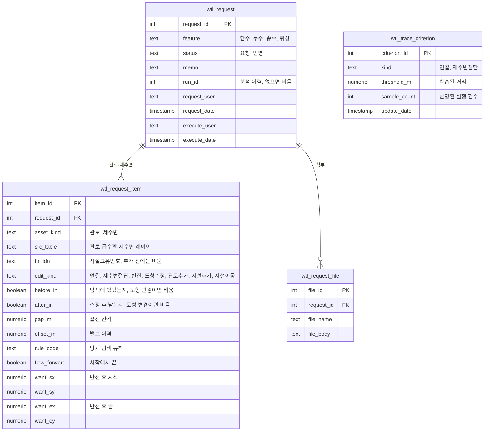

# 작업계획서

2026-11-06 | 213am | docs/brief/20261015_1649_단수구역도형편집.md, docs/brief/20261015_1759_누수분석.md, docs/brief/20261015_1828_송수경로.md, docs/brief/20261015_1842_위상검증.md

## 개발목표

단수구역, 누수분석, 송수경로, 위상검증은 수정요청을 같은 테이블에 저장한다. 일반 계정은 수정요청만 남기고, 아이디가 su인 계정만 실행한다. 다른 슈퍼 계정은 실행 권한에 넣지 않는다. 서버에서도 su가 아니면 실행을 거부한다. 위상검증 탭에 들어올 때 접합확인필요와 유수방향 확인필요를 포함한 오류 목록 전체는 관로·시설 원본에서 다시 계산해 화면에만 보여 주고, 그 목록은 어떤 테이블에도 저장하지 않는다.

수정요청 한 번은 `wtl_request`에 저장한다. 기능, 요청 또는 반영 상태, 메모, 요청 계정과 시각, 실행 계정과 시각이 들어간다. 그때 고른 관로·제수변은 `wtl_request_item`에 한 행씩 저장한다. 레이어, 시설고유번호, 수정 방식, 수정 전후 포함 여부, 끝점 간격, 밸브 이격, 당시 탐색 규칙, 반전 후 시작·끝 좌표가 들어간다. 수정 방식 컬럼 이름은 `edit_kind`다. 해당하지 않는 값은 비운다. 첨부는 `wtl_request_file`에 저장한다. 행 번호는 저장하지 않는다. 원본을 고칠 때만 시설고유번호로 현재 행을 찾는다. 아직 없는 시설 추가는 번호가 생기기 전까지 비운다.

학습 대상은 시설별 예외가 아니다. 빠져서 탐색되지 않은 관로는 연결 정답이고, 제수변 이후로 넘어간 관로는 그 제수변에서 절단하는 정답이다. `su`가 실행한 항목의 끝점 간격과 밸브 이격으로 `wtl_trace_criterion`의 연결 기준과 제수변 절단 기준을 갱신한다. 따라가는 순서는 소스에 둔다. 사례가 부족하면 소스의 기본 간격을 쓴다. 같은 형태의 정답이 반복되면 그 거리를 다음 탐색의 기본 기준으로 쓴다. 반전, 도형 수정, 관로 추가, 시설 추가, 시설 이동은 학습에 넣지 않고 관로·시설 원본만 바꾼다. 반전은 저장된 시작에서 끝이 되도록 맞추고, 이미 그 방향이면 다시 뒤집지 않는다. 학습된 기준은 코드 배포 때 옮기지 않고, 관망을 통째로 복제할 때만 함께 옮긴다. 데이터베이스 반영 실행과 세 탐색을 하나의 그래프로 합치기는 이번 범위가 아니다.

## 플로우차트

```
단수|누수|송수 → 수정요청 → (su 실행) → 간격·이격으로 연결·절단 기준 갱신 → 다음 탐색
위상 → 수정요청 → (su 실행) → 반전·도형·추가·이동은 원본 반영
위상 탭 진입 → 오류 목록 재계산(저장 없음) → 수정요청
```

## DB 설계

스키마는 레이어다. 위상검증 오류 목록용 테이블은 두지 않는다. 수정요청은 `wtl_request`에 모으고, 학습 결과는 `wtl_trace_criterion`에 둔다. 기준 테이블은 요청 항목과 외래키로 연결하지 않는다.



`wtl_request` 한 행은 수정요청 버튼 한 번이다. 기능이 단수, 누수, 송수, 위상 중 무엇인지와 상태, 메모, 요청·실행 계정과 시각이 들어간다. 그 요청에서 고른 관로·제수변은 `wtl_request_item`에 나뉜다. 접합확인필요에서 낸 도형 수정·추가·이동과 유수방향 확인필요에서 낸 반전도 같은 테이블에 저장한다. 첨부는 `wtl_request_file`이다.

`wtl_trace_criterion`은 연결 한 행, 제수변 절단 한 행이다. `su`가 실행한 항목 중 `edit_kind`가 연결이거나 제수변 절단인 행의 끝점 간격과 밸브 이격을 모아 거리를 다시 계산한다. 시설고유번호별로 규칙을 만들지 않는다. 실행 전에는 기준이 바뀌지 않고 관로·시설 원본도 바뀌지 않는다. 반전·도형 수정·추가·이동을 실행하면 원본만 바꾼다. 원본을 찾을 때 시설고유번호는 논리적 참조이고, 레이어에 외래키 제약은 걸지 않는다. 반전 좌표는 레이어 좌표계다.

## 수정추가파일

추가 | src/database/schema/wtl_request.ts
  -> 네 탭 수정요청 한 건

추가 | src/database/schema/wtl_request_item.ts
  -> 요청에 포함된 관로·제수변과 수정 방식

추가 | src/database/schema/wtl_request_file.ts
  -> 수정요청 첨부

추가 | src/database/schema/wtl_trace_criterion.ts
  -> 학습된 연결 거리와 제수변 절단 거리

수정 | src/database/schema/index.ts
  -> 스키마 목록 반영

추가 | src/service/wtlRequestService.ts
  -> 수정요청 저장, su 실행, 연결·절단 기준 갱신

수정 | src/service/index.ts
  -> 수정요청 서비스 등록

수정 | src/service/wtlOutageService.ts
  -> 단수 탐색에 학습된 연결·절단 거리 적용

수정 | src/service/wtlLeakService.ts
  -> 누수 탐색에 학습된 연결·절단 거리 적용

수정 | src/service/wtlSupplyPathService.ts
  -> 송수 탐색에 학습된 연결·절단 거리 적용

수정 | src/service/wtlTopologyService.ts
  -> 오류는 조회만, su 실행은 시설고유번호로 현재 행을 찾아 시작·끝에 맞춤

추가 | src/app/(pages)/map/_mapContents/wtlAdmin/spatialAnalysis/traceFeedback/TraceFeedbackBar.tsx
  -> 단수·누수·송수 수정요청. 일반 계정은 요청만, su는 실행

수정 | src/app/(pages)/map/_mapContents/wtlAdmin/spatialAnalysis/outage/WtlOutagePanel.tsx
  -> 단수 결과에서 관로·제수변 수정요청

수정 | src/app/(pages)/map/_mapContents/wtlAdmin/spatialAnalysis/leak/WtlLeakPanel.tsx
  -> 누수 결과에서 관로·제수변 수정요청

수정 | src/app/(pages)/map/_mapContents/wtlAdmin/spatialAnalysis/supplyPath/WtlSupplyPathPanel.tsx
  -> 송수 결과에서 관로·제수변 수정요청

수정 | src/app/(pages)/map/_mapContents/wtlAdmin/spatialAnalysis/topology/WtlTopologyPanel.tsx
  -> 오류 목록은 진입 시 재계산, 수정요청과 su 실행

수정 | src/app/(pages)/map/_mapContents/wtlAdmin/spatialAnalysis/topology/WtlTopoRequestModal.tsx
  -> 반전·도형·추가·이동 수정요청 저장

재사용 | src/app/(pages)/map/_mapContents/wtlAdmin/spatialAnalysis/outage/useWtlOutageMapLayer.ts
  -> 보정 반영 후 단수 결과 다시 그리기

재사용 | src/app/(pages)/map/_mapContents/wtlAdmin/spatialAnalysis/leak/useWtlLeakMapLayer.ts
  -> 보정 반영 후 누수 결과 다시 그리기

재사용 | src/app/(pages)/map/_mapContents/wtlAdmin/spatialAnalysis/supplyPath/useWtlSupplyPathMapLayer.ts
  -> 보정 반영 후 송수 결과 다시 그리기
