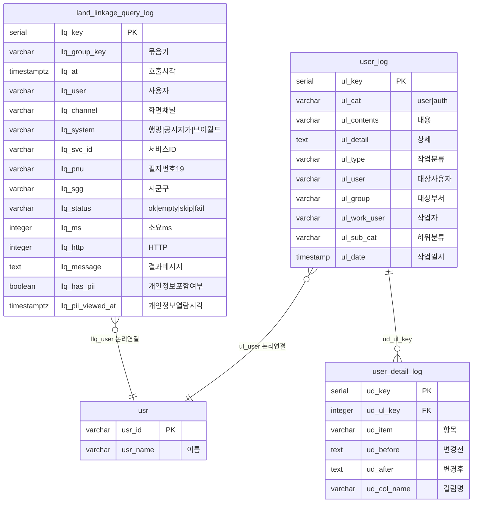

# 작업계획서

2026-11-25 | 213am | 연계·개인정보 열람 감사 및 보고서

## 개발목표

지도 우클릭 필지정보 등에서 행망·공시지가를 조회한 시각·사용자·필지·서비스·성공 여부를 남기고, 그 조회가 개인정보(소유자 등)를 포함한 열람인지와 열람 시각을 함께 남긴다. 기존 «데이터 이력관리»(로컬 변경·되돌리기)와는 분리한다.

사용자별 현재 권한과 권한 변경 이력은 이미 «사용자 권한 관리 이력» 체계가 있으므로 그 저장을 쓰되, 이번 작업에서는 열람 감사와 같이 보고서에서 조회·출력할 수 있게 연결한다. 권한 변경을 연계 조회 이력 테이블에 억지로 넣지 않는다.

1차는 응답 전문·성명 원문을 저장하지 않는다. 개인정보 포함 여부·열람 시각·호출 메타만 남기고, 기간·사용자 기준으로 열람·권한 현황을 뽑는 보고서를 제공한다. 배치·파일 동기화는 제외한다.

## 플로우차트

우클릭·모달·분석 조회 → 행망 호출(또는 건너뜀) → 조회·개인정보 열람 이력 저장 → 개발자 목록·묶음 상세 → 보고서(열람·권한)

권한 부여·변경 → 기존 권한 관리 이력 저장 → 보고서에서 함께 조회

## 기능목록

1. 마우스 우클릭 필지정보·공유인·이동/변동연혁·공시지가 모달·필지분석·이용계획 조회 이력을 남긴다.
2. 호출 1건당 시각·사용자·화면·시스템·서비스·필지번호·상태·소요·메시지를 저장한다.
3. 개인정보가 포함된 정보·데이터를 조회했는지 여부(포함/미포함)를 남긴다.
4. 개인정보 포함 정보를 열람한 시각을 남긴다(마스킹 설정과 무관하게 «열람 시도·표시» 기준).
5. 한 화면에서 여러 서비스를 친 경우 묶음 키로 묶어 상세에서 함께 본다.
6. 개발자 메뉴에 «연계 조회 이력» 목록을 두고 기간·필지번호·서비스·상태·사용자·개인정보 여부로 검색한다.
7. 사용자별 권한·권한 변경 이력은 기존 «사용자 권한 관리 이력»을 사용·보완하고, 연계 조회 테이블과 섞지 않는다.
8. 보고서: 기간·사용자(또는 부서) 기준으로 개인정보 열람 시각·건수·연계 조회 요약과 권한·권한 변경 요약을 출력(화면 미리보기·파일 내려받기)한다.
9. 응답 전문·성명 원문·되돌리기·변경 전후 비교는 두지 않는다.
10. 이력·보고서 저장/조회 실패가 지도 본 조회 화면을 막지 않는다.
11. 배치·파일 동기화는 이번 범위에서 제외한다.

## 테이블설계

### 구분 요약

| 구분 | 테이블 | 스키마 작업 |
|------|--------|-------------|
| **신규 생성** | `land_linkage_query_log` | 테이블·인덱스 새로 만듦 |
| **기존 재사용 (스키마 수정 없음)** | `user_log` | 권한·권한 변경 이력 헤더. 컬럼 추가·변경 없음 |
| **기존 재사용 (스키마 수정 없음)** | `user_detail_log` | 권한 변경 상세(전·후). 컬럼 추가·변경 없음 |
| **기존 재사용 (스키마 수정 없음)** | `usr` | 사용자 마스터. 조회·표시용만. 수정 없음 |
| **스키마 수정 대상** | (없음) | 1차 범위에서 기존 테이블 ALTER 없음 |

보고서·권한 이력은 위 기존 테이블을 **조회만** 하고, 저장 구조는 바꾸지 않는다. 연계 조회와는 사용자 아이디로만 논리 연결(외래키 없음).

### ERD

### 신규 테이블 상세 — `land_linkage_query_log`

인덱스: 호출시각 내림차순, 필지번호+시각, 서비스+시각, 묶음키, 사용자+시각, 개인정보포함+열람시각.

값 규칙:
- 호출 1회 = 1행. 같은 화면 동작은 묶음키 공유.
- 개인정보포함여부는 소유·공유인 등 해당 서비스면 참, 아니면 거짓.
- 개인정보열람시각은 포함이 참일 때 채우고(보통 호출시각과 동일), 거짓이면 비움.
- 응답 전문·성명 원문 컬럼은 두지 않음.

### 기존 테이블 — 스키마 변경 없음

- `user_log` / `user_detail_log`: 권한 부여·변경 이력이 여기 쌓이는 전제. 비어 있거나 기록 누락이 있으면 **서비스·화면 보완**으로 채우고, 테이블 구조는 유지.
- `usr`: 보고서·목록에 이름 표시할 때만 조인.
- `data_log` / `data_detail_log`(데이터 이력관리): **이번 범위에서 사용·수정하지 않음.**

## 수정추가파일

추가 | src/database/schema/land_linkage_query_log.ts
  -> 연계 조회·개인정보 열람 여부·열람 시각 이력 테이블

수정 | src/database/schema/index.ts
  -> 이력 스키마 등록(배럴)

추가 | src/service/landLinkageQueryLogService.ts
  -> 이력 저장·목록·묶음 상세·열람 집계

수정 | src/service/index.ts
  -> 이력·보고서 서비스 등록

수정 | src/service/landLinkageService.ts
  -> 우클릭·모달·분석 호출·건너뜀 직후 이력·개인정보 여부 적재

수정 | src/service/userLogService.ts
  -> 권한 이력 목록이 보고서에 쓰이도록 조회 보완(필요 시)

추가 | src/service/landLinkageAuditReportService.ts
  -> 열람·권한 요약 보고서 생성

추가 | src/app/(pages)/dev/_components/LandLinkageQueryLogContent.tsx
  -> 연계 조회 이력 목록·묶음 상세

추가 | src/app/(pages)/dev/_components/LandLinkageAuditReportContent.tsx
  -> 감사 보고서 미리보기·내려받기

수정 | src/app/(pages)/dev/_components/devConsolePanels.tsx
  -> «연계 조회 이력»·보고서 메뉴 연결

수정 | src/app/(pages)/dev/_components/UserMgmtHistory.tsx
  -> 권한 이력 화면이 보고서·감사 흐름과 맞도록 보완(필요 시)
